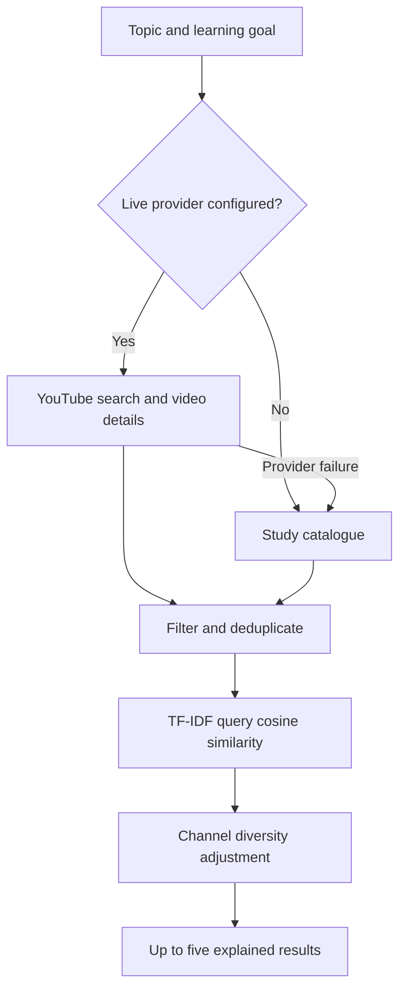

# YTGuide

**A focused YouTube learning workspace with explainable recommendations.**

Pick a subject, get up to five relevant lessons, and study with notes, a focus timer, and saved progress. The project began in a college Python/ML workshop and has been developed into a deployable web application.

## What works

- Seven subjects: Python, web development, Java, machine learning, SQL, Linux/Bash, and data structures.
- Query-to-video TF-IDF cosine similarity, deduplication, and channel diversity.
- A maintained catalogue of 39 candidates with public YouTube metadata checked on 26 October 2026. Candidate availability can subsequently change.
- Optional live YouTube Data API retrieval, with explicit catalogue fallback on missing credentials, provider failure, or quota exhaustion.
- Language filters and duration filters. Unknown language/duration never silently satisfies a strict filter. Fewer than five results is valid.
- Responsive light/dark interface, keyboard navigation, reduced-motion support, and an accessible native lesson dialog.
- User-initiated YouTube embeds, no app feed/comments, no autoplay, and a YouTube link if embedding fails.
- Saved lessons, notes, manual completion tracking, Markdown note export, and a 15/25/50-minute timer.
- Workspace data stays in local browser storage. There are no accounts, cloud sync, tracking scripts, or fabricated counters.

**Current deployment runs in catalogue mode until a new `YOUTUBE_API_KEY` is configured.** The application shows its actual source above the results. Live integration has mocked automated coverage; a successful real-key production request still needs to be verified after setup.

## Run locally

Requires Python 3.12+ and a modern browser. Production has no third-party Python dependencies or frontend build step.

```sh
python scripts/dev.py
# Open http://localhost:3000
python -m unittest discover -s tests -v
node --check public/app.js
```

Node is only needed for the optional syntax check, not to serve the app. Standalone Python does not automatically load `.env` files. Use your shell or IDE's environment configuration if testing live mode locally; do not commit a key.

## User walkthrough

1. **Discover lessons:** choose a study topic and language. Add a specific goal such as “functions” or “neural networks.” Select a duration if useful, then click **Find my lessons**.
2. Read the source notice. **Study catalogue** always uses local candidates. **Automatic** uses live retrieval when configured; **Live YouTube** explicitly reports fallback if unavailable.
3. Expand **Why this lesson?** for matched terms. This explains text relevance; it is not an accuracy, popularity, or teaching-quality score.
4. Click **Watch lesson**, then **Load YouTube player**. The second click intentionally connects to YouTube; playback does not auto-start. If playback is unavailable, use **Open on YouTube**.
5. Write notes in the focus space. They save on this device after each change. **Mark complete** is self-reported progress, not video-watch telemetry.
6. Use **+** to save a lesson. Open **My workspace** to revisit it. Removing a save does not delete its notes.
7. Start a focus timer from the sidebar or lesson dialog. The lesson timer opens alongside your notes without stopping playback. Closing the lesson keeps the timer running in the corner. Pausing preserves the remaining time; changing session length resets it. Hiding the timer does not stop it. Reloading the page resets the timer.
8. Export notes from **My workspace** to keep a Markdown backup. Clearing browser storage deletes local workspace data.

On mobile, use the navigation below the logo and the appearance button in the top bar.

## Why change the workshop implementation?

Building a dataset yourself was a reasonable experiment. Uploading it to Kaggle was not a model-quality guarantee. The actual weaknesses were:

| Original behavior | Current behavior |
| --- | --- |
| Select the first row for a topic, then find its nearest neighbors | Rank the user's actual subject/goal query against candidates |
| Fixed title-only bag-of-words similarity matrix | Fit smoothed TF-IDF over candidate text for each request |
| Duplicate videos and mixed entertainment/placement results | Deduplicate by video ID; subject-scoped teaching catalogue |
| Old cached results presented without freshness context | Explicit catalogue/live source and provider-failure notices |
| Link out immediately to YouTube's full browsing UI | Deliberate lesson player, notes, progress, and timer |
| Fake “Like” counter that reset each run | No fabricated engagement metrics |
| API credentials and exception output in a notebook | Sanitized notebook, server-only environment variable |
| Streamlit/Heroku-style deployment with incomplete dependencies | Static frontend + Vercel Python function |

Original code and artifacts are preserved under [`legacy/`](legacy/). They are not loaded in production. Never unpickle an untrusted artifact. Historical API keys have been removed from the current notebooks, but **they remain in Git history and must be revoked in Google Cloud**. History was not rewritten.

## Recommendation pipeline



The implementation is in [`api/recommend.py`](api/recommend.py).

- Tokenize lowercase alphanumeric terms and remove a small stopword list.
- Use `idf(t) = log((1 + N)/(1 + df(t))) + 1` and sublinear `tf = 1 + log(count)`.
- Normalize document and query vectors, then compute cosine similarity.
- Discard zero-overlap candidates and malformed/duplicate IDs.
- Greedily select by `cosine / (1 + 0.25 × number_of_already_selected_videos_from_channel)`.
- Return matched terms. Similarity is never displayed as a “quality percentage.”

This is a statistical content-based retrieval model. It is not a deep-learning model, a generative chatbot, or a system trained on student outcomes. It cannot identify the objectively best five videos on all of YouTube. More computationally expensive AI is not automatically better for this small retrieval task.

For live results, retrieval asks for embeddable, syndicated videos and excludes known nonpublic, unembeddable, live/upcoming, and under-three-minute candidates. Declared audio metadata is required for a strict language selection. Retrieval still does not guarantee that a video will play in every region/browser.

The 15-minute in-memory cache has a finite keyspace of topic × language, including negative caching on provider failure. It is per function instance, **not a global rate limiter or a global quota guarantee**. User goal text reranks candidates without creating another provider search key.

## Architecture and files

| File | Responsibility |
| --- | --- |
| `public/index.html` | Accessible page structure and UI content |
| `public/styles.css` | Responsive layout, theme tokens, reduced motion |
| `public/app.js` | Search, dialog/player, local workspace, notes export, timer |
| `api/recommend.py` | Validated API, YouTube adapter, cache, ranking |
| `api/catalog.json` | Maintained candidate metadata and editorial tags |
| `scripts/dev.py` | Local static/API server matching production paths |
| `scripts/check_catalog.py` | Refresh titles/authors through YouTube oEmbed |
| `scripts/enrich_catalog.py` | Refresh duration from public watch-page metadata |
| `scripts/seed_catalog.py` | Initial candidate seed; not a production refresh job |
| `tests/` | Retrieval, fallback, caching, HTTP regression checks |
| `vercel.json` | Deployment layout and security headers |
| `INTERVIEW_GUIDE.md` | Decisions, limitations, and interview walkthrough |

The production path does not need a database, model download, paid LLM, Kaggle access, npm install, or framework runtime. This choice keeps the demo lightweight and makes the Python recommendation code easy to inspect. Local storage is a conscious tradeoff: no account friction, but no cross-device sync.

## Deploy on Vercel

Use the Git repository with **Framework Preset: Other**, **Output Directory: public**, repository root as Root Directory, and no custom build command. Vercel detects `api/recommend.py` as the Python function. Only `public/` is served as static files; legacy notebooks/model files are not public web assets.

### Enable live retrieval

1. In Google Cloud, enable **YouTube Data API v3** in your own project.
2. Revoke the two historical exposed keys. Create a new key restricted to YouTube Data API v3. Never reuse the notebook keys.
3. Add `YOUTUBE_API_KEY` as a Secret in Vercel → ytguide → Settings → Environment Variables, scoped to the environments you intend to use. Enter the value there, not in chat or source code.
4. Redeploy. Search with **Live YouTube** and confirm the visible notice says live candidates. `/api/recommend?action=meta` exposes only whether a key is configured, never its value.
5. Verify successful retrieval, strict language behavior, duration filters, and fallback on an invalid test key in a nonproduction environment.

No paid services or plan upgrades are necessary for catalogue mode. Live mode consumes your YouTube project's quota. Before opening the live provider to substantial public traffic, add shared caching and distributed rate limiting, plus provider-side quota controls. Vercel's per-instance cache is insufficient for that job.

## Data and evaluation

Catalogue titles/authors are checked using YouTube's public oEmbed endpoint. Durations were read from public video metadata, and may be missing if retrieval fails. Language and tags are editorial annotations. oEmbed success proves metadata availability at check time, **not successful playback or educational quality**. `tests/catalog-check.json` records the latest metadata-check outcomes.

The automated suite verifies application correctness. It does not establish recommendation superiority. To substantiate an ML research claim, the next work is:

- Build a separately judged benchmark of learning goals and relevance labels, with explicit annotation criteria.
- Compare a simple keyword baseline, the current ranker, and a sentence-embedding ranker on held-out queries using nDCG@5, MRR, and coverage.
- Split by video/channel or time where appropriate to avoid evaluation leakage; do not tune on the test set.
- Separately measure learning outcomes and distraction reduction in a consented user study. Clicks alone are not learning quality.

## How this differs from a YouTube blocking extension

Extensions can hide feeds across YouTube. YTGuide offers a bounded learning decision, an explanation, and a workspace for notes and progress without installing an extension. It does **not** replace a blocker, control other tabs, remove ads, or suppress all related videos inside YouTube's player. `rel=0` limits suggestions to the same channel; it does not remove them.

## Credits and contribution

The original app credits **Kushagra Pandey, Aryan Gupta, Harsh Mishra, and Ayush Nishad**, guided by **Chandan Verma**. Preserve that team history when presenting the workshop work.

Kushagra supplied the student-distraction problem, the original workshop context and project, and the modernization requirements. The modernization's code, tests, design, and documentation were implemented with AI assistance under that direction. Do not invent individual authorship percentages; explain and demonstrate the portions you personally understand, changed, and tested.

## Limitations and next steps

- Catalogue mode is finite and maintained, not a continuously refreshed YouTube index.
- TF-IDF misses semantic synonyms and deep instructional quality. Channel diversity is a heuristic.
- Language metadata may be missing or wrong; strict filtering trades coverage for honesty.
- YouTube can remove videos, change embedding rights, show ads, or restrict regions after metadata checks.
- Notes/progress are local, unencrypted browser data. Shared devices are shared workspaces.
- Focus timer is a study aid and resets on reload; it is not watch-time measurement.
- No guarantee of zero bugs, academic acceptance, job placement, or production-scale robustness.

Prioritize benchmark labels and real student feedback before adding accounts, embeddings, or an LLM. If cloud sync becomes necessary, add authenticated access and a database with per-user authorization, then test those boundaries separately.

## Primary references

- [YouTube search endpoint](https://developers.google.com/youtube/v3/docs/search/list)
- [YouTube video details](https://developers.google.com/youtube/v3/docs/videos/list)
- [YouTube player parameters and `rel`](https://developers.google.com/youtube/player_parameters)
- [YouTube API quotas](https://developers.google.com/youtube/v3/getting-started)
- [Vercel Python functions](https://vercel.com/docs/functions/runtimes/python)
