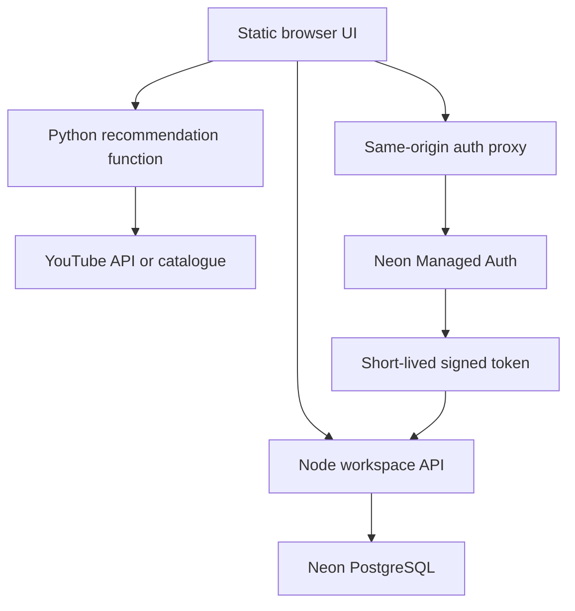

# YTGuide system design

## Problem and scope

A student wants a bounded shortlist of useful lessons and a workspace that survives a device change. Recommendation discovery remains public. Personal data requires an account. The first version used only local storage; this version adds persistence without making signup a prerequisite for trying the site.

No chatbot, video hosting, social feed, collaborative editing or payment system is part of this release.

## Request boundaries



These are modules/functions in one Vercel project, not a claim of a separately operated microservices platform. Python stays with retrieval; Node uses official SQL/auth ecosystem packages for account features.

## Recommendation model and data

The Python function normalizes the actual goal and selected technology spellings, retrieves current YouTube metadata or reads the maintained catalogue, and filters candidates by topic/language/duration. The goal is included in both live retrieval and the shared PostgreSQL cache key.

`lib/semantic.py` runs the pretrained multilingual MiniLM model through quantized ONNX Runtime on CPU. The query and each title/tags/description become normalized 384-dimensional vectors using attention-mask mean pooling. Inputs are truncated to 128 tokens. Cosine similarity estimates semantic relevance. The ranker combines 80% semantic score and 20% TF-IDF score, rejects semantic scores below 0.30, then greedily reduces repeated-channel exposure using a 0.15 penalty. These coefficients are heuristics, not probabilities or an optimized learning-to-rank model.

The active catalogue has 54 verified metadata entries. The 139 valid unique legacy candidates are separate and unverified. We do not train the neural network on either dataset; they supply candidates and development evaluation examples. No transcripts, video understanding, chatbot, collaborative filtering or training on private notes are implemented. Missing or failed inference uses labelled keyword fallback.

PostgreSQL stores shared successful candidate responses for 15 minutes, short-lived failures, in-flight leases and a daily retrieval budget. Metadata embeddings also have a bounded per-instance cache. This avoids adding Redis for the current workload, but cache expiry alone is not a database retention policy; old cache-row cleanup is future work.

## Schema and invariants

| Table | Key | Important invariant |
| --- | --- | --- |
| `learner_profiles` | `user_id` | Minimal app profile; managed auth owns credentials |
| `learner_lessons` | `(user_id, video_id)` | One user's state per video; independent saved/completed/position fields |
| `lesson_notes` | `(user_id, video_id)` | One versioned main note per lesson; 8,000 characters maximum |
| `lesson_bookmarks` | `(user_id, id)` | Timestamp+label belongs to that user's lesson |
| `study_collections` | `(user_id, id)` | Unique collection name per user |
| `collection_lessons` | `(user_id, collection_id, video_id)` | Composite foreign keys cannot attach another user's collection or lesson |
| `workspace_imports` | `(user_id, import_id)` | Retry receipt for a deterministic import batch |
| `workspace_rate_limits` | `(user_id, window_start)` | Shared per-minute counters rather than per-instance-only counters |
| `ytguide_migrations` | `version` | Applied migration receipt |

`learner_lessons(user_id, updated_at DESC)` supports recent-workspace reads. Bookmark lookup is indexed by user/video/time. Small display metadata snapshots use JSONB; core relationships and progress remain typed columns. This is deliberate denormalization, not an attempt to put every entity in one JSON blob.

## Authentication is not authorization

1. The auth proxy forwards only allowlisted session/signup/signin/verification/recovery routes to the configured provider. It cannot become an arbitrary proxy or expose managed admin endpoints.
2. Managed Auth owns passwords and browser sessions. Session cookies stay HTTP-only on the application origin.
3. The browser gets a short-lived JWT for the workspace service; it keeps the token in memory and sends `Authorization: Bearer`.
4. The workspace API validates EdDSA signatures against cached provider JWKS, issuer, audience, expiry, required claims and the banned flag.
5. It derives user identity from the verified token. It does not accept a request body's `user_id` as authority.
6. Every workspace query uses that verified user ID. Resource mutations check ownership; composite foreign keys reinforce it.

The application role currently enforces ownership in parameterized SQL. Setting transaction-local user context is not a claim that row-level security policies already enforce isolation. RLS with a dedicated least-privilege role is an additional hardening option if a direct database/data API is introduced. Database credentials are server-only.

## Notes and concurrency

A note read returns `content` and `version`. A save includes the last version the editor saw:

```text
UPDATE note ... WHERE user_id = verified_user AND video_id = requested_video AND version = expected_version
```

The server increments the version on success. If it changed meanwhile, the API returns HTTP 409 and the latest note. The browser retains its local draft and asks the user to choose. Retrying a lost-response save whose content already matches the server is treated as success, not a false conflict.

This is optimistic concurrency, not a CRDT or collaborative text editor. If live multi-user collaboration becomes a requirement, revisit the data model rather than pretending this mechanism merges paragraphs.

Saved/completed/position are separate field patches. This avoids a stale whole-workspace snapshot wiping unrelated data. Their policy is last accepted update per field; a position can decrease when a student intentionally revisits earlier content.

## Local-first write path

1. Update the visible workspace and local scoped cache.
2. Persist an operation in the authenticated user's outbox.
3. Send operations serially; merge queued note edits and position changes when safe.
4. Clear an operation only after server confirmation.
5. Retain failed operations and expose retry/session-expiry/conflict status.

Guest storage and per-account storage have separate namespaces. Switching accounts changes the active namespace. Normal sign-out clears a fully synced account cache; explicit sign-out with pending changes retains a recovery cache. No auth token/password is stored in that cache.

Limits: this is a practical outbox, not a fully specified multi-tab replicated database. Concurrent browser tabs sharing local storage should not be presented as collaborative editing. Note version conflicts protect the server, while a future cross-tab coordination mechanism can improve the client further.

## Guest migration

Import is explicit because a browser can be shared. Each batch contains at most 25 lessons plus bounded collections/bookmarks. A content-derived UUID gives repeat imports the same receipt.

- Merge saved/completed flags with OR.
- Preserve the larger imported resume position.
- Keep an existing cloud note; retain the guest original locally for review/export.
- Use unique IDs/constraints to avoid duplicate bookmark/membership rows.
- Commit the batch and receipt in one transaction.

An interrupted multi-batch import can be retried. Previously applied batches are recognized; this is retry safety, not a claim of exactly-once execution across arbitrary external services.

## Deployment and failure behavior

The deployment region is configured as Singapore alongside the database; inspect actual runtime placement rather than assuming every request executes there. The static UI is delivered through Vercel's CDN. The SQL driver uses serverless HTTP connections, avoiding a new persistent connection pool for every invocation.

Migrations are additive and run during the build with an advisory transaction lock. Preview fixture checks exercise actual managed authentication and database behavior before production publication. Production builds skip synthetic signup tests.

| Failure | Behavior |
| --- | --- |
| YouTube key absent/quota failure | Automatic: labelled catalogue fallback; explicit Live: actionable error |
| Invalid filters/body/resource IDs | 400/413/415 rather than an unsafe query |
| Workspace request without a valid identity | 401 |
| Attempt to modify another user's collection | 404; other user's data unchanged |
| Stale note version | 409 + conflict workflow |
| Database/auth temporarily unreachable | Pending changes retained; 503/retry status |
| Browser storage unavailable | Warning; do not claim local durability |
| Player unavailable | Visible message and YouTube link |

## Scale and trade-offs

For an interview demo, the priorities are correctness, observable failures and defensible scope. The next scaling steps would be pagination/cursors for larger workspaces, stronger public abuse controls and expired-cache cleanup, a least-privilege database role, backup/restore drills and account deletion/retention workflows. Add Redis only if measured workload or a cross-instance coordination requirement justifies another system.

Measure recommendation quality with a separately judged held-out query set, nDCG@5/MRR/coverage and simple baselines. Measure learning outcomes separately. Do not equate watch time, clicks or completion checkboxes with understanding.
